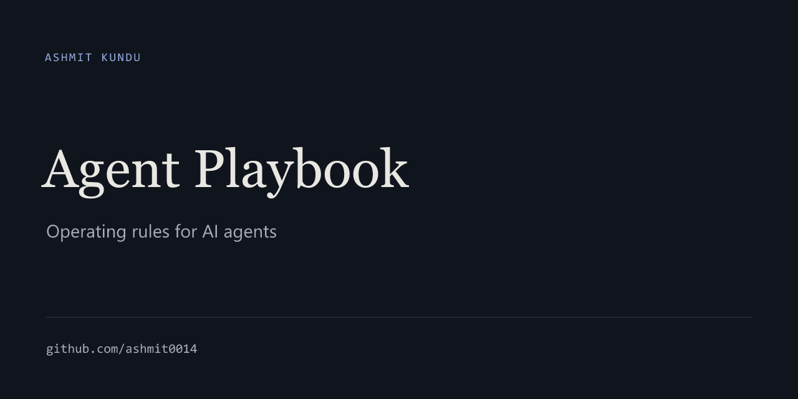

<!-- profile-editorial-cover -->
<picture>
  
</picture>

# Agent Playbook

**Operating rules for AI agents (Claude, Fable, Opus, Codex, ChatGPT and others) doing real work with little supervision.** It covers software, research, analysis, writing, planning and audits. The rules are distilled from real projects that failed, were measured and were corrected, not from generic productivity advice.

## Use it

1. Open **https://ashmit0014.github.io/agent-playbook/**.
2. Pick the kind of work and where you will paste the prompt, and optionally type your goal.
3. If the page lists a file (for a new project, `PLAYBOOK.md`), download it and put it in your project folder, or attach it in a chat app.
4. Press **Copy prompt** and paste it into your agent.

Nothing is installed or loaded in the background. You see exactly what the agent gets.

The site offers five prompts:

| Prompt | For | Files |
|---|---|---|
| **Quick task** | One sitting, low stakes | None; self-contained |
| **New project** | Software or product work over several sessions, with the agent leading | `PLAYBOOK.md` (required) in the project root. The agent creates `AGENTS.md`, `STATE.md` and `DECISIONS.md` itself |
| **Research or analysis** | Investigations, data analysis, audits, decision memos | None. `PLAYBOOK.md` is optional for long investigations |
| **Writing or creative** | Writing and design where your taste decides | None |
| **Continue a project** | Resuming a project started with *New project* | The project's own `AGENTS.md`, `STATE.md` and `DECISIONS.md`, or your saved notes in a chat app |

Every prompt contains the nine-principle [Core](CORE.md). The new-project prompt also points the agent at specific sections of `PLAYBOOK.md`, to be read when they become relevant.

## What it is, and what it is not

It is a small body of rules about the decisions that most often go wrong when an agent works on its own:
- what counts as evidence that something works;
- what to prove first;
- what to decide alone and what to bring to the human;
- when to stop iterating;
- how to use other models without mistaking agreement for truth;
- how to keep context useful;
- where to spend expensive reasoning.

It is not a framework, a plugin or an agent platform. It does not try to make agents fully autonomous; it tries to put the human exactly where human judgment or authority is needed.

## Files

| File | What it is |
|---|---|
| [CORE.md](CORE.md) | Nine principles, about 340 words. Included in every prompt |
| [PLAYBOOK.md](PLAYBOOK.md) | The operating layer: decision rules, defaults, stop conditions, review, context, resources. About 3,500 words |
| [REFERENCE.md](REFERENCE.md) | Why each rule exists, the earlier rules it corrected, conditional rules, how it was tested |
| [EVIDENCE.md](EVIDENCE.md) | What each rule rests on: cases, measurements, external sources |
| [CHANGELOG.md](CHANGELOG.md) | Version history |
| `index.html` | The website's prompt builder. It reads `CORE.md` and `PLAYBOOK.md` directly, so prompts and downloads always match the canonical files |

## How rules are labelled and changed

Every rule in the playbook carries one of these labels:
- **Rule:** held across every kind of work in the evidence.
- **Default:** do it unless the situation clearly differs.
- **Current models:** an observation about today's models and tools, expected to go stale as they improve. These are the parts to recheck first.
- **Provisional hypotheses** are listed in [REFERENCE.md](REFERENCE.md) §7, outside the playbook, until evidence promotes or drops them.

A rule changes only on evidence stronger than what supports it now. Each change gets a [CHANGELOG](CHANGELOG.md) line and an [EVIDENCE.md](EVIDENCE.md) row. If it overturns an earlier rule, it also gets a row in the corrections table in [REFERENCE.md](REFERENCE.md) §3. Versions are `major.minor`: minor for wording, prompts and evidence; major when a Rule changes.

## Provenance

The rules come from seven private projects over about five weeks: games, mobile apps, an image-generation workflow, a data-safety tool and a machine audit. They also draw on token telemetry from 387 agent sessions and on published research on agent instruction files and code review. The public files describe that evidence in anonymized, aggregate form; the underlying records are kept privately.
